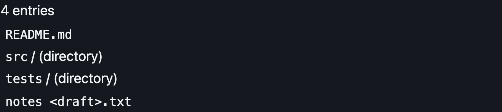
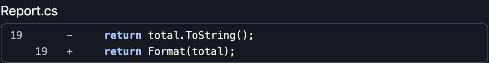
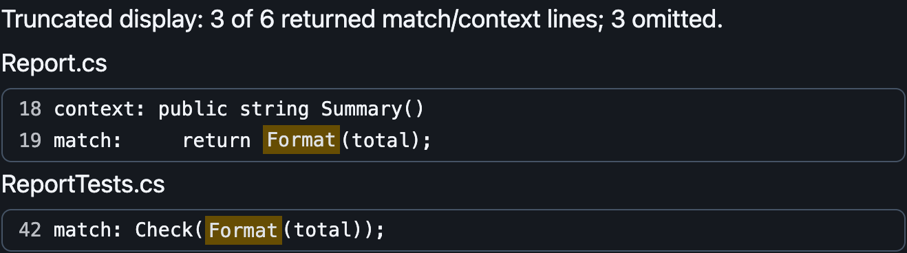
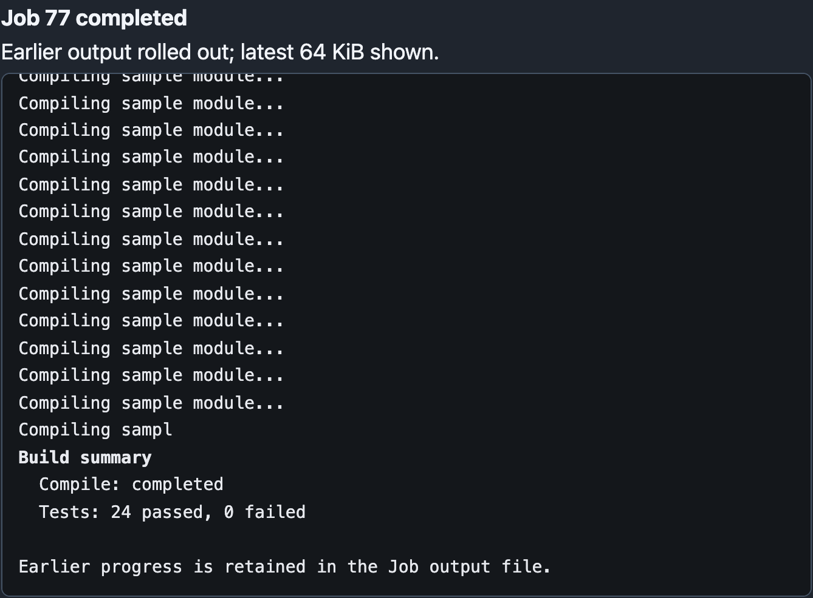
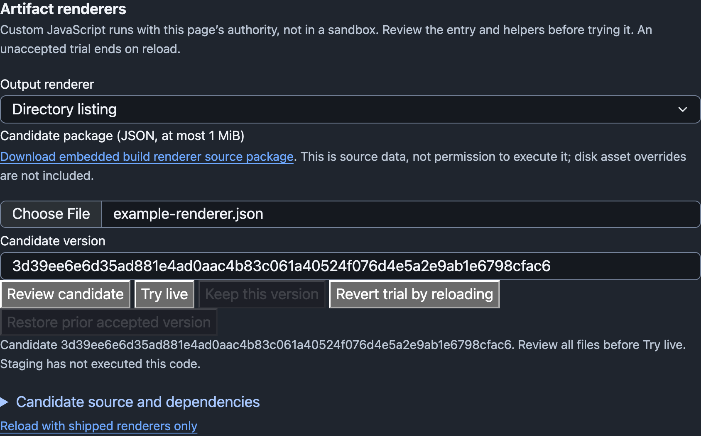
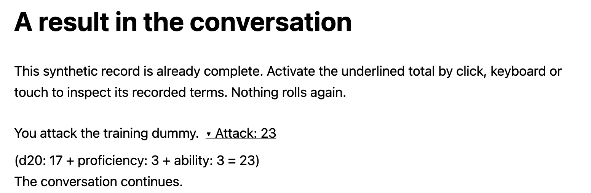

# Chapter 28: Advanced Artifacts

A readable tool result lets the human check the Agent's work while it is still
useful to intervene. Raw output remains necessary evidence, but asking a person
to reconstruct a file edit or a continuing command from text fragments makes
supervision harder than it needs to be. This chapter gives presentation its own
editable code without giving it ownership of the work it describes.

> **Verification boundary.** The implementation has bounded local verification.
> One isolated student attempt exercised the directory slice and informed the
> teaching; one editorial review followed. Neither establishes reconstruction of
> the full chapter. Figures use synthetic fixtures; installed human usability
> remains unverified. The [development notes](../docs/edition-3-notes/advanced-artifacts.md)
> retain detailed evidence and verification limits.

## TL;DR

Package readable renderer modules beside skills, with shared helpers under
`skills/shared`. A skill's `renderers:` mapping associates tool names with relative
JavaScript entries; it neither grants tools nor approves browser execution.
Explicit packaging determines which shipped assets the GUI serves. Installed
source and short API notes let an Agent adapt presentation without a checkout
or loading every helper into its model context.

Keep recorded content, identity, call/result pairing and lifecycle in their
existing owners. Renderers receive bounded presentation inputs. Capture directory,
file and search evidence during the operation; retain it through History and
replay separately from model-facing text. Missing evidence means unavailable
metadata, not an empty successful operation. Success presentation requires a
successful result. Detailed shapes and bounds appear in
[Implementation reference](#implementation-reference).

Provide directory, read, write, exact-edit and search previews; a configurable
default for other tools; shared prose rendering for chat and readable thinking;
and a terminal-log renderer for continuing commands. Preview functions return
detached elements. Prose and command functions update a supplied body in place.
The GUI retains a final literal-text fallback outside the customization chain.

Correlate a continuing command by its actual Agent, Job and recorded originating
call. Preserve each historical observation independently. Explicit wait/input
observations foreground the same session node; background polling does not move
it. Fetch the latest 64 KiB through an owned read-only output window, independent
of the model cursor. Mark rollover and reset terminal styling at that boundary.
Preserve unchanged DOM, selection and scroll, and reject stale responses after
replay or Agent changes. A finished observation does not imply a finished Job.

Approval applies to an immutable version containing the entry and all declared
executable dependencies. Stage is inert; Try live executes only in the current
page; Keep saves the accepted version; reload discards an unaccepted trial.
Retain a previous version and shipped-only recovery. Compare the expected
accepted version when saving so stale tabs cannot silently overwrite a choice.
Selections are shared across Agent views, independent per renderer.

Approved code runs with page authority. Review and supervision do not contain
it. Safe helpers treat output as data, but cannot constrain malicious approved
JavaScript. The implemented approval keys are `list_directory`, `read_file`,
`write_file`, `edit_file`, `search_files`, `tool_default`, `prose`, and `command`.
Additional registered tools, including MCP tools, have namespaced approval choices
shared by exact tool name across Agents. Without an accepted specialized renderer,
they use the configurable default. Discovery itself never executes renderer code.
Iframe isolation and a general extension installer remain outside this chapter.

Demonstrate that Artifact identity does not require a card through a standalone
inline dice fixture. Its host supplies recorded facts; revealing their explanation
never rolls again. Workflows and multi-agent orchestration belong to the Puffin
codebook, not this implementation increment.

## In plain words

A tool result is part of the conversation between a person and an Agent. Its
presentation determines how much work the person must do to understand what
happened. A directory listing should look like a directory listing. A change to
a source file should make the changed lines easy to find. A debugger session
should remain a session while the Agent asks it another question.

Consider a user asking for directories to stand apart from other entries. When
presentation is embedded in GUI special cases, changing that display requires
finding and modifying the application. With a skill-owned renderer, the Agent starts from the skill that provides the listing,
reads the renderer and its interface, and changes that presentation. A second
Agent using the same tool gets the same improved display. The original directory
result remains available even if the custom renderer fails.

The small example establishes the extension mechanism. It should also establish
how the human can understand the change: which renderer was selected, which data
it received, and what the new code does with it. The Agent can explain those facts
while the user still has a chance to steer. A natural-language formatting request
is a programming request with a human reviewing the result.

### Reuse a helper without reading a library

A renderer that needs Markdown can reuse the supplied safe rendering module.
The Agent needs to know the helper's inputs, outputs and important restrictions. It usually
has no reason to read the parser's implementation. A short library index points
to that information; detailed source is available when the task needs it.

The browser can load a parser as an executable dependency while the model knows
only where to find its API documentation. That separation keeps useful code
available without spending context on every library in the installation. The
same packaging idea serves a Python helper used by several tools or a Go package
used by workflow executables. Each language keeps its ordinary execution model.

### A dice total is enough of an Artifact

Bill's Homebrew-VTT example makes the visual requirement concrete. The application
has a chat pane, and a dice tool's result belongs in that conversation. For
example, a result could appear as “Attack: 23.” Clicking it reveals
“d20: 17 + proficiency: 3 + ability: 3.” The fixture uses a native disclosure,
opened with Enter or Space after keyboard focus and by tapping on touch devices.

That display needs the recorded calculation and a small interaction. It does not
need to resemble a source-code card. Revealing the explanation also must not roll
again. The Artifact's identity and content let the renderer explain the event;
the chosen shape makes it useful in that application. Shared UI helpers should
make ordinary displays easy without imposing a universal card template.

### Foreground the work that already exists

Suppose the Agent starts a debugger, receives a prompt, then turns to a source
file. A later `send_input` addresses that same running process. The human should
see the debugger log return to the bottom of the Tools pane and continue
displaying output. Input still travels through the tool; the view adds no terminal
input widget or full-screen debugger emulation. Starting a new visual snapshot for every
interaction forces the reader to assemble the session mentally.

History still records the individual operations. Sending input, waiting for
output and receiving a result are different facts with their own identities.
The continuing Artifact is a view assembled from those facts and the Job's
retained output. It does not own the process or turn an observation into proof
that the process exited. Reopening the browser must preserve that distinction.

A busy process can produce more output than either the reader or the model needs
at once. The human gets a scrolling window of the latest 64 KiB, with a visible
indication of older retained output. The model gets the bounded observation it
requested. Reading more in the browser should not consume the next model
observation or make every model request carry the display buffer.

File operations need a similar respect for what happened. Appending text to an
existing file does not make its first displayed line line 1. If the previous
last line had no newline, the append may continue that line. The renderer needs
facts captured by the operation; reading the file later could describe another
edit entirely. Attractive line numbers are useful only when they identify the
right lines.

### Choose trust deliberately

Bill supervises the code being written for his installation and has chosen to
run approved renderers directly in the page. This makes inline interaction and
ordinary DOM integration available without an iframe boundary. The choice also
means the renderer is trusted application code. Watching its development helps
review it; it does not technically prevent that code from accessing the page.

A downloaded skill needs an explicit trust decision before its JavaScript runs.
Until then, the host can show the ordinary readable result. Even approved code
must handle result text as data: a malicious filename should remain a filename.
An isolated renderer mode may be useful later, but that is a separate security
and integration feature. The first directory display should not require building
an untrusted-extension platform.

## Teach the renderer what actually happened

Keep the surrounding controls smaller than the content. A result header can say
“Job 1 completed,” with labeled download, paired-call and speech icons on that
same line. Show local time and observation duration together; retain the full
recorded timestamp and duration meaning in accessible descriptions. A running
snapshot still says “running when observed,” not that the process is running now.

Result bodies scroll rather than requiring payload expansion. Where complete
structured evidence is available, show it directly. Otherwise fetch the latest
64 KiB of owned Job output independently of the model cursor. Preserve incomplete
structured facts and label the additional plain-text tail; do not parse that tail
to invent missing entries or positions. A failed fetch leaves the recorded
observation visible with an explicit notice. Ordinary cards fetch once; the
continuing command view described below owns live updates. Speech and durable
history retain the original observation, not the fetched presentation window.

Start with a directory listing. Splitting its text at newlines appears to produce
one entry per line, until a filename contains a newline. A trailing slash can be
a useful display convention, but it is a poor replacement for a recorded type.
The renderer should not have to reverse-engineer the tool's prose.

The operation already enumerates entries. At that point it can record each name
as an individual string and any kind it actually established. The native listing
confirms directories; other entries remain `unknown`. A failed directory check
does not prove that an entry is a regular file: it may have disappeared. The
renderer gives confirmed directories a textual label and leaves uncertain kinds
uncertain. HTML-looking names become text nodes.

This evidence travels beside the ordinary result through Job completion and
History serialization. The model still receives its bounded textual observation.
The human preview has its own bound and a total count, so it can say how much of
the listing it displays. An empty recorded list can be shown as empty; an old
record with no evidence falls back to its text. Those are different inputs.

Capturing during execution also settles replay. If the directory changes after
the tool returns, the old Artifact must continue to describe the old operation.
A renderer that refreshes the directory to improve its display has silently
changed the evidence under review.

{style="display: block;"}<!-- Caption follows; retain descriptive alt without a duplicate figure caption. -->

*Directory preview with synthetic recorded entries. Names remain literal, and confirmed directories carry a text label.*

### Positions belong to the operation

A source excerpt needs a starting line, not a browser guess. An append needs more:
if the old content ends halfway through line 8, the new content begins on line 8,
at the next column. Adding a newline at the end of the inserted text terminates
that line; it does not mean content was written on the following empty line.

The write implementation scans the existing content through the same opened
handle used for append, then seeks to its end and writes. Positions use one-based
lines and UTF-16 columns, matching the runtime's string indexing. It reports the
written range to the model as well as supplying evidence for the GUI. A useful
fact should not be hidden from the Agent merely because the GUI can display it.
This same-handle sequence does not promise protection from unrelated concurrent
writers.

Prepare and validate presentation metadata before changing a file. Otherwise a
successful mutation could be followed by a metadata-validation exception and
reported as a failed tool. Attach success evidence only after the write and its
flush/disposal succeed. Empty content reports no written content. A refused
exact edit remains a refusal, regardless of how attractive its proposed diff
would have looked.

For an exact replacement, record the removed anchor and inserted text at the
applied position. Bill found that separate **Removed** and **Inserted** blocks
made nearby changes difficult to compare: the reader had to find each changed
line twice. Render a unified replacement diff instead. Interleave unchanged
context, `−` removed lines and `+` inserted lines, with old/new line-number
columns. Show three context lines around each change and label omitted unchanged
runs. The comparison covers the applied replacement, not necessarily the whole
file. Never reread mutable files to reconstruct operation-time evidence.

Use the locally bundled jsdiff 9.0.0 `diffLines` implementation, retaining its
BSD-3-Clause license. Its three-module dependency chain belongs to the edit
renderer's exact-version review package, not a page-global library. Compare only
complete captured segments, at most 32 KiB each. Bound comparison with
`maxEditLength: 256` and `timeout: 25`. The timeout is cooperative, not a hard
browser execution deadline. If comparison aborts or either segment is truncated,
show clearly labeled before/after excerpts and explain why there is no unified
diff. Never present a prefix comparison as a complete patch. Mark missing final
newlines explicitly, including when only that boundary changed.

Keep file headings compact, including edits: a basename, with the full path available
in its tooltip and accessible label. Append positions fit beside the basename,
for example `sample.go · appended at 4:17`. The numbered source supplies ordinary
line positions without a repeated paragraph. One outer result preview owns
vertical and horizontal scrolling; do not nest another height-limited source
scroller. Preserve source layout without wrapping by default.

The source highlighter is a lexer chosen by suffix; unknown suffixes remain
literal. A mid-line fragment may begin inside a string or comment, so display
it literally rather than guess the missing lexical context. Identify the partial
line and its UTF-16 column. Numbering and colors help reading, but the underlying
captured text remains unchanged; presentation gutters are not edit anchors.

{style="display: block;"}<!-- Caption follows; retain descriptive alt without a duplicate figure caption. -->

*Earlier before/after presentation from synthetic operation evidence. Bill’s usability review led to the unified replacement diff described above; this figure awaits refresh after the revised view is accepted.*

### Search captures spans once

Search results require a different shape from a contiguous source excerpt. They
may contain several context windows, gaps and matches within one line. The tool
captures the .NET regular expression engine's UTF-16 spans while producing its
existing textual result. The browser groups by recorded path and highlights
those spans. Show only each basename in the heading, with its full path in the
hover tooltip and accessible label. Files sharing a basename remain separate
groups. Omit routine match/context totals; retain explicit truncation notices
and a concise no-matches message. It does not rerun the expression with JavaScript semantics.

A line with no spans is context. A span of length zero is a genuine zero-width
match and needs a visible boundary indicator. Bounds apply to complete lines
and their spans together: if a line cannot fit, omit it and report the omission
rather than display it with some matches mysteriously missing. Showing all
returned lines still does not prove every file was readable; recursive search
retains its existing best-effort behavior for inaccessible files.

{style="display: block;"}<!-- Caption follows; retain descriptive alt without a duplicate figure caption. -->

*Grouped search from synthetic evidence. Recorded spans identify matches; the notice distinguishes displayed lines from all returned lines.*

## Keep the presentation code available

The useful unit of discovery is a short API description. An Agent changing line
number styling needs to find `file-excerpt.js`, learn what positions mean, and
inspect the relevant implementation. It does not need the Markdown parser's
source in every model request.

Build the shared ownership before adding renderer metadata. Create
`skills/file-reading/SKILL.md` as a dependency skill owning `read_file`,
`list_directory` and `search_files`. In `ensemble`, `full` and `local-coding`,
add `file-reading` to the existing dependencies and remove those three duplicate
tool declarations. Preserve every other dependency, tool and loadable skill.
The dependency loader activates this owner first and only once. Check each
primary's effective enabled-tool set before and after: this is an ownership
refactoring, not permission to give a small local model more tools.

Make the directory slice the first executable checkpoint. Capture and validate
its evidence, carry it through the Job and durable codec, and test clipped text,
empty success, missing evidence and provider exclusion. Then add the renderer
mapping, explicit packaged asset and literal fallback. Validate discovery without
executing JavaScript; separately load the reviewed shipped module and exercise
its DOM. This is a useful partial implementation, not completion of approval,
other evidence types or continuing sessions.

The installed layout makes that sequence ordinary:

```text
skills/
  file-reading/
    SKILL.md
    renderers/              directory, read, search; README.md
  code-tools/
    SKILL.md
    renderers/              write and edit entries
  shared/
    README.md               helper index
    file-excerpt.js
    file-diff.js
    jsdiff/                 pinned comparison modules, license and provenance
    source-code.js
    markdown.js
    markdown-parser.js
    tool-default.js
    command-output.js
    terminal-output.js
    inline-dice.js
    inline-dice.html
```

The shared directory is source and documentation, not an activatable skill.
Other languages can use ordinary shared files there when a concrete tool needs
them; this implementation introduces no cross-language loader. Browser imports
and model reads are separate operations with separate purposes.

The GUI embeds an explicit list of reviewed assets and fingerprints them when
mapping its routes. It does not serve any arbitrary file placed beside a skill.
The shipped-package download comes from those embedded sources, not an optional
mutable asset override. A source edit on disk therefore does not silently change
a running page. Customization uses the versioned trial mechanism below.

The existing `app.js` is a classic script. Load renderer ES modules with dynamic
`import()` from the fingerprinted asset location; do not add static imports to
the classic entry point. A successful C# build does not check this browser
contract. A small isolated browser fixture can intercept its requests and supply
known result facts, then assert literal hostile-looking filenames, omission
labels and fallback. Installed Playwright does not imply an installed browser:
use an explicitly approved installed executable or report that check unavailable,
rather than downloading one silently. Test actual host asset delivery separately;
an intercepted module fixture does not establish integration.

Prose needs its complete dependency chain too. Its package contains the renderer,
lexer and locally pinned Markdown parser adapter, with the parser's license.
Depending on an invisible page-global parser would leave the reviewed package
incomplete. Chat and supplied readable thinking use the same prose entry; this
changes presentation, not which thinking content a provider makes available.

## One continuing command, several recorded observations

Consider a command that prints a prompt and waits for input. The initial
`run_command` observation can return while the process remains alive. Later,
`send_input` has its own call ID and result. Replacing that call ID with the
original command's ID would damage correlation; giving every observation a new
terminal view would make the human assemble the session manually.

The Job already retains its originating call. Its snapshots now expose that
origin separately from the current observation's identity. The browser uses the
Agent address, Job handle and original call ID to find one session node. Only
records whose origin is explicitly `run_command` create this view. Legacy records
without an origin stay ordinary observations instead of being guessed into a
session.

Historical calls and results remain intact, but preserving history does not
require displaying the same output twice. Once an identified session has usable
output, successful command, wait and input results show a compact link to that
session, with their immutable text available in a closed Recorded observation
disclosure. Errors remain visible. A missing origin, failed session fetch or
unavailable session restores ordinary recorded output rather than hiding it.

When a wait or input observation explicitly foregrounds the session, the GUI
moves its existing node to the bottom of Tools. Background polling updates that
node where it is, without a model wait call or a second per-observation fetch.
Neither action reruns the command. The model still receives each observation's
output and status: it cannot see the human's browser. If the session module loads
late, it takes over outstanding ordinary output fetches without changing the
recorded text. Replay resets the association; links must validate the current
card, Agent, Job and originating call before focusing a session.

### Separate the human window from the model cursor

Joining observation strings cannot reliably reconstruct output: those strings
may contain head/tail clipping, omitted bytes or already-seen text. The GUI uses
a separate read-only endpoint. It resolves the actual owner's Job, opens that
Job's output file through its Sandbox, and reads a bounded tail ending at the
snapshot's published byte count. The browser supplies identity, never a path.

The response transports bytes as base64 with start/end offsets and recorded
origin. Reading this stream leaves the model's observation cursor untouched.
The model can request a small report while the human inspects a larger window.
Earlier output remains on disk. The existing browser download is for completed
Jobs and is limited to 16 MiB; larger output needs local access to the owned file.

A page reset aborts fetches, clears timers and advances a generation. A response
that arrives afterward must match the live generation and session origin before
it can paint. Reconnect rebuilds associations from recorded facts and can fetch
the current tail of an available owned Job. It cannot recover a destroyed Job
or reconstruct an exact old terminal screen. Historical observations remain
readable when live output is unavailable.

### A terminal log has a smaller contract than a terminal

The shipped decoder handles basic SGR colors and bold/reset formatting. Cursor
movement, terminal hyperlinks and other terminal commands have no application
effect. Carriage-return progress is presented as log lines rather than emulated
screen overwrites. There is no interactive editor, clipboard command or terminal
emulation layer hidden in the display.

A 64 KiB tail can start inside a UTF-8 character or an escape sequence. The decoder
drops a leading UTF-8 continuation prefix and defers an incomplete trailing code
point. It starts styling afresh for each snapshot. If the opening escape byte
has rolled out, the remaining characters are ambiguous; the notice warns that
partial control fragments may appear. Guessing them away could delete genuine
output. A bounded log cannot reconstruct terminal state whose bytes it discarded.

The GUI caches unchanged windows so polling does not repeatedly replace their
spans. If the human selects output, a changed snapshot waits until selection
clears, including when that snapshot is final and polling has stopped. Focus and
scroll position govern tail following. The same bounded snapshot can be repainted
after a renderer change without another fetch. Custom code receives a copy of
the decoded byte buffer: mutation followed by an exception must not corrupt the
literal fallback's input.

{style="display: block;"}<!-- Caption follows; retain descriptive alt without a duplicate figure caption. -->

*Continuing command view from synthetic observations and a synthetic 64 KiB response. The displayed test count is illustrative data, not an Ensemble test receipt.*

## Review code, try it, then keep it

A request such as “make directories easier to distinguish” starts a small code
change. The Agent can obtain the shipped package, read its entry and helpers,
change the relevant presentation, and explain the result. Reading or staging
that package does not execute it.

The settings panel separates the next decisions:

1. Select the output type and stage the candidate source package.
2. Review its files, including imported helpers.
3. **Try live** to approve this exact candidate for the current page.
4. Inspect existing and newly arriving output, then **Keep** if it is useful.
5. Use **Revert** or reload to discard an unaccepted trial. Roll back an accepted
   version when needed; use shipped-only recovery to bypass custom imports.

A trial is page memory, never a persisted startup preference. Keep records an
accepted content hash and retains the previous accepted choice. Each output type
has independent selections shared across Agent views. The panel allows one active
trial at a time so switching types cannot lose track of an unaccepted experiment.

The store hashes the entry and declared files together. Editing a helper creates
a new version requiring review. Promotion compares the accepted version the page
observed with the current durable selection, under a cooperating-writer lock.
A stale tab receives a refusal instead of silently replacing another decision.
Save failure leaves the selection unchanged. If a response is lost after a save,
the page cannot infer whether acceptance happened; refresh and inspect rather
than automatically repeating the mutation.

{style="display: block;"}<!-- Caption follows; retain descriptive alt without a duplicate figure caption. -->

*Actual approval controls with an inert synthetic candidate. Open the source disclosure to review code before Try live; Keep remains unavailable until a trial.*

### An unfamiliar tool is still a tool

Suppose Bill connects an MCP tool named `remote_weather`. Its result should not
need a new GUI build before he can customize its presentation. The host reads the
actual registered Tool objects across its Agents and offers **Tool: remote_weather**
in the same approval panel. It does not connect a server, enable a skill or fetch
JavaScript merely to populate that list. Reload discovers later registrations.

There is a subtle identity trap here. An MCP tool can be named `command`, but
that name must not select the continuing terminal renderer. Additional tools use
separate approval keys: `tool-` plus the lowercase SHA-256 of the exact UTF-8 name.
The browser keeps their render functions in a separate tool-name map. The eight
shipped presentation choices remain unchanged. Same-name tools across Agents
share a choice; this is not proof that two servers use compatible output formats.

Bill stages a package and reviews its executable helpers exactly as before. There
is no fabricated shipped package for the new tool. Its renderer receives bounded
preview text, which may be an incomplete JSON document, and only whatever optional
evidence the operation actually supplied. If it cannot render those facts faithfully,
it declines and the default takes over. Never reread a resource or repeat the tool
just to make its result prettier.

If the tool disappears before approval, the request refuses. If it is absent at
page load, its saved choice remains on disk but is not imported. Already approved
code in an open page remains until reload; presentation permission is not tool
execution permission. These deliberately separate lifetimes keep customization
from becoming another tool-grant mechanism.

### Approval is trust, not containment

Approved JavaScript runs inside the application page. It can access conversations,
change controls and issue page-authorized requests. The Agent's filesystem and
process sandbox does not follow that code into the browser. Supervised development
provides review and detection, not a browser security boundary.

Version hashes prove which declared bytes are being served. They do not prove
that those bytes contain no external imports or network behavior. Review must
account for that authority. The loader serves declared snapshot files, but ordinary
JavaScript can do more than import them.

Safe shipped helpers still matter: filenames use text nodes, Markdown disables
raw HTML, links are restricted, and remote images become escaped placeholders.
These properties keep hostile result data from becoming executable content through
the helpers. They do not make malicious approved code safe. An import can perform
side effects before throwing; a fallback cannot undo them. Reload clears trial
module state, not arbitrary damage. Shipped-only recovery avoids loading accepted
custom code when the defect survives Keep.

## An Artifact without a card

Bill's dice example separates identity from the visual container. In the shipped
standalone fixture, the chat host retains a synthetic record ID and immutable
facts: an attack total of 23 from a recorded 17, proficiency 3 and ability 3.
`inline-dice.js` returns a native disclosure whose summary shows the total. Opening
it reveals the terms. There is no random source or reroll callback.

The renderer checks that bounded integer terms sum to the recorded total. A
mismatch refuses to the host's raw-record fallback rather than inventing a repaired
calculation. Native disclosure supplies keyboard and touch behavior without a
second interaction framework. The example uses a visible focus outline and a
44-pixel-high target; labels and arithmetic carry meaning without color.

This fixture is distributed source, explicitly opened through a local static
server. It is not registered in Ensemble's page, does not add a dice tool, and
does not change Tools-pane routing. Its lesson transfers to another host: retain
the original event and identity while choosing a shape appropriate to that
conversation.

{style="display: block;"}<!-- Caption follows; retain descriptive alt without a duplicate figure caption. -->

*The distributed inline fixture, opened with its synthetic recorded result. Revealing the arithmetic does not roll again.*

## Implementation reference

### Declarations and invocation

A tool skill declares relative JavaScript entries in its existing front matter:

```yaml
renderers:
  list_directory: renderers/list-directory.js
```

Reject duplicate tool names, absolute/traversal entries and non-JavaScript files.
Metadata grants neither tools nor execution. Shipped source still uses explicit
host packaging; this declaration is not downloaded-module activation. Additional
registered tools use the guarded name-discovery endpoint and explicit approval
flow described above, not arbitrary skill-directory serving.

Each renderer entry is an ES module whose **default export** is the rendering
function: `export default function render(...)`. The signatures below describe
three separate entry contracts:

```javascript
// Tool previews: return a detached HTML element.
render(document, boundedText, directoryEvidence, fileEvidence, searchEvidence)
// Chat and readable thinking: synchronously update the supplied body.
render(parent, text, allowCopy)
// Continuing command output: synchronously update the supplied body.
render(parent, bytes, rolledOut)
```

A missing, throwing, inapplicable, invalid or already-connected tool-preview result
falls through to `tool_default`, then to host literal text. Prose and command
renderers have their own literal host fallback. None owns the card, raw text,
speech, status, call/result links, polling or Job lifetime. The host schedules
updates and defers them during selection. Renderer changes invalidate the relevant
presentation cache, not recorded facts.

### Recorded presentation inputs

Directory evidence is `{total_entries, entries: [{name, kind}]}`. Retain at most
256 entries and 32 KiB of UTF-8 names. Kinds are `directory`, `file` or `unknown`;
the current native operation leaves non-directories unknown. Report omitted
entries from the total; absence of evidence invokes text fallback.

File evidence is `{operation, path, start_line, start_column, content, removed}`.
Each excerpt is `{text, total_bytes}` with at most 32 KiB of UTF-8 text. Positions
are one-based, columns measured in UTF-16 code units. `removed` belongs only to
edits. Reads describe the requested, byte-capped read; they do not certify unseen
file content. Empty excerpts have no invented written line. A shorter excerpt
than its recorded total must be marked as truncated.

Search evidence is `{lines, total_lines}`. Each line has `{path, number, text,
matches}`, each match `{start, length}` in zero-based UTF-16 units. Retain at most
256 complete lines, 32 KiB of path-plus-text UTF-8 bytes, and 256 spans per line.
Stop before a line that cannot fit. Count omitted returned lines, not presumed
unread files or matching occurrences.

Validate bounded evidence before retaining it and attach it only to successful
observations. Keep it optional in durable serialization for old records. Job
observation delivery retains the evidence independently of text clipping and
emits it once. Provider request normalization and redaction omit presentation
metadata; the model-facing write range remains ordinary result text.

### Versioned source and output transport

A staged source request is `{"entry":"relative.js","files":{"relative.js":"source"}}`.
The selected renderer identity joins it in the stored package. Require an existing
entry, one to 64 declared JavaScript files, safe relative paths, valid source text,
and both source and encoded-package size bounds of 1 MiB. Hash the canonical
package and verify its identity on reopen. Never accept a changed file under an
old approved version.

`/renderers/shipped?renderer=NAME` downloads inert embedded source. Selection,
package, stage, accept and rollback operations reuse the existing guarded host.
Mutation requires the origin and `X-Ensemble-Renderer: 1` guard. Promotion is
renderer-specific and compares the expected accepted hash. Storage belongs to
the GUI host, independently of Agent settings; hosts without configured renderer
storage remain shipped-only. The [installed API note](../agent/skills/file-reading/renderers/README.md)
describes each shipped dependency package.

`/jobs/window?agent=ADDRESS&handle=HANDLE` requires the existing same-origin/site
checks and `X-Ensemble-Output: 1`. Its response is `{handle, status, start, end,
rolled_out, encoding, data, origin_call_id, origin_tool}`. Encoding is `base64`;
start is `max(0, end - 65536)` at the published snapshot. Refuse a shorter file,
foreign ownership or a download request on this endpoint. The GUI validates
identity, offsets, lengths and generation before painting. Live polling pauses
when its page or pane is hidden; reset cancels its observations without cancelling
the underlying Job.

Test the transport boundary as well as the renderer. During Bill's hands-on
review, real reads fell back to plain text even though tool-evidence tests and
synthetic browser tests passed. Display reconstruction had omitted the evidence
when rebuilding result events from retained conversation entries. A regression
must carry actual dispatched read, directory and search evidence through GUI
projection, including snapshot-only replay. Then test the browser presentation.
Neither side alone proves the information survives between them.

## Take it for a spin

Use an isolated instance with disposable files. Start with a directory containing
a subdirectory and an HTML-looking filename, then inspect a read beginning partway
through a source file. Compare an exact replacement's unified diff
with its captured before/after text, including separated changes and a missing
final newline. Run a controlled process that prints, waits for input and
prints again; inspect its continuing output alongside the separate observations.

In Speech & Display settings, select a shipped renderer, download its package and
make a small presentation change. Stage it, review the source, Try live, and
reload before Keep. The reload should restore the accepted or shipped version.
Repeat with Keep, then exercise rollback and shipped-only recovery. These steps
change reviewed browser code; use a controlled candidate and preserve a recovery
route before experimenting.

Serve the installed `skills/shared` directory with a local static HTTP server and
open `inline-dice.html`. No package installation is needed. Open the explanation
by keyboard and touch and compare it with the supplied record. This is a synthetic
example rather than a transcript of a real game.

The implementation checks separate the evidence layers. Native tool tests exercise
captured facts and durable codecs. HTTP tests exercise owned output windows and
per-renderer approval. Actual-page browser fixtures supply controlled facts and
check rendering, interaction, fallback and replay. Distribution checks compare
copied source bytes and run the standalone fixture without a repository checkout.
These tests do not constitute a real-provider end-to-end session, screen-reader
acceptance, or proof that a fresh student can reconstruct this chapter. Detailed
commands and outcomes remain in the development notes rather than a claimed
chapter-wide certification score.

## Exercises

These exercises apply the implementation reference. Local regression tests are
available, but there is no independent chapter grader or completed reconstruction
claim for this increment. Use local fixtures and isolated application
instances; publication, live-service changes and paid inference are not required.

### 1. Make a directory listing useful

Implement the first skill-owned renderer for `list_directory`. Use a small
fixture containing files, directories and a name containing HTML-like characters.
Keep the displayed entries faithful to the tool result and distinguish directories
without relying on color alone. Change the format in response to a short human
request, then explain the files changed and show the result.

At this checkpoint, edit the reviewed shipped renderer and rebuild/reload the
isolated host, or demonstrate the change in an isolated module fixture. The
versioned trial panel comes later. Keep fixture evidence distinct from host
integration.

Demonstrate the readable fallback when no custom renderer is supplied and when
custom rendering fails. Use the renderer declaration and preview interface in
the reference section. Keep the existing tool's execution and access rules.

### 2. Package the renderers and discover their helpers

Move the existing Artifact rendering code into the agreed skill structure,
including chat/readable thinking and the default presentation. Factor common
Markdown and code-display helpers into the shared library area. Keep host
transport, authoritative identity and tool authority with their existing owners.

From a disposable distribution directory with no repository checkout, locate the
renderer source, discover a helper through its concise documentation, and use it
from two renderers. Verify that ordinary model requests do not acquire every
library's source code. Include a small inline dice-result fixture with an
explanation accessible by click, keyboard and touch. No Homebrew-VTT deployment
or React migration is required.

### 3. Show file contents and changes at their real positions

Add suffix-based code highlighting and line numbers for reads and writes, plus
unified replacement diffs for successful exact edits. Compare two changes
separated by unchanged lines; verify old/new numbers, explicit gaps and a change
to the final newline. Require clearly labeled before/after fallback for truncated
evidence or an exhausted comparison budget. Use a file read starting partway down
the file, an ordinary write, an append after a trailing newline, and an append
to an unterminated line. Show the resulting line numbers and the actual edited
region. Keep a readable presentation for an unknown suffix.

Make a refused edit and a failed write visibly unsuccessful. Partially generated
write arguments may be displayed as proposed content, but must not be labeled as
a completed write. Show that the presentation preserves the original result and
that the comparison
extent is labeled accurately. Explain the metadata captured by
the operation rather than infer historical positions from a later file read.

### 4. Group search results without losing their meaning

Render matches from several files with file grouping, line numbers, highlighted
matches and the returned context. Exercise adjacent matches and a bounded result.
Preserve returned content and make truncation explicit. Include markup-like text
in a match to check that display remains data. The renderer must not silently
rerun the search or open extra files merely to decorate the result.

### 5. Keep one command session in view

Use a controlled local process that emits colored output, accepts input and stays
alive across multiple observations. Render its supported ANSI output in one
continuing Artifact. Call `wait_for_job`, then `send_input`, and verify that the
same presentation is foregrounded at the bottom of the Tools pane. Background
output alone must not continually move it there. Avoid duplicating terminal echo.

Generate more than 64 KiB. Check the bounded tail display, UTF-8 boundary handling,
explicit styling reset, an older-output indication, and retained output on disk. Keep the model's smaller observation limit unchanged. While reading
older visible output, test selection, focus and scroll preservation. Reconnect
and verify the continuing view without restarting the process or duplicating
output. History must retain the distinct calls and observations, with final Job
state separate from each observation's completion.

### 6. Exercise trust and fallback on the actual page

Present an unapproved renderer and verify that it remains unexecuted while the
safe result is readable. Then deliberately Try a controlled fixture and
exercise its renderer. Verify that reload discards the trial, Keep survives reload,
rollback restores the prior selection, and shipped-only recovery bypasses custom
code. Change a helper and require a new version; refuse stale or cross-renderer
promotion without changing the saved selection. Treat filenames, search text, Markdown and command escape
sequences as data even in this trusted mode. Check that content alone cannot
request a tool action, remote image fetch or executable markup through the
provided safe helpers.

Record the trust boundary honestly: in-page approved JavaScript has application
privileges. These checks establish the selected helper and approval behavior,
not isolation from malicious approved code. Review the useful rendered examples
with the human before closing the increment. Do not expand this exercise into
iframe implementation or a universal extension-security certification.

Next: [Crossing Over to Ensemble](chapter-29.md).
