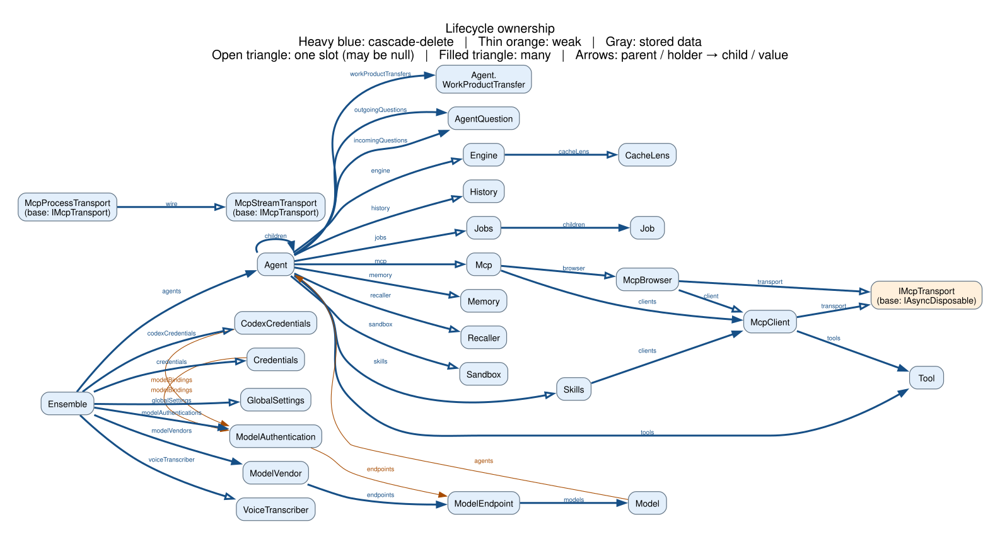

# Ensemble's Common data structures

Start with the map and the one-line class guide in
[Chapter 0: Learn the system’s vocabulary](../../book/chapter-00.md#learn-the-systems-vocabulary).
The printed chapter contains the full-page map and all 28 lifecycle-type
descriptions; these companion files are not required to understand the print copy.

## Browse

- Open `index.html` locally for the self-contained searchable viewer. GitHub shows
  HTML source rather than running the viewer; clone/download it and open the file.
- [Lifecycle overview: SVG](ownership.svg) · [PDF](ownership.pdf)
- [History and recorded data: SVG](history.svg) · [PDF](history.pdf)
- [Models and authentication: SVG](models.svg) · [PDF](models.pdf)
- [Memory and recall: SVG](memory.svg) · [PDF](memory.pdf)
- [Tools, jobs and MCP: SVG](tools.svg) · [PDF](tools.pdf)
- [All Common structures: SVG](all.svg) · [PDF](all.pdf)
- [Text relationship list](relationships.md) · [Declaration inventory](inventory.json)

The current snapshot merges 63 Common files into 165 declared types. The full
graph contains 156 nonstatic types and 216 arrows; the lifecycle overview has
28 types and 36 reviewed relationships. PDFs use diagram-sized vector pages,
not the book's fixed print layout. Matching `.dot` files are editable sources.

## Read the arrows

- **Heavy blue:** strong ownership; teardown cascades, including joined work.
- **Thin orange:** weak relationship; teardown detaches rather than deleting.
- **Gray:** stored data reference or value containment, with no destruction claim.
- **Outlined triangle:** one slot, possibly empty. **Filled triangle:** many.

Arrows run from parent/holder to child/value. Back-references appear in the
textual details instead of duplicate reverse arrows. Multiple parents point to
the same child box; the Agent self-edge means nested Agents, not self-ownership.
Transport boundaries are owned/disposed without invented model back-pointers.
Base classes and interfaces are labels, not containment arrows.

The inventory is broader than the lifecycle map: immutable values, snapshots
and supporting structures are included. “Stored” means an instance field or
property, not necessarily durable disk state. Framework types, primitives,
enums, static helpers, computed accessors and local variables are outside the
node set. Task results and callback parameter types do not become data arrows.

## Keep the map current

The [generator and checks](../../scripts/common-diagram/README.md) parse declarations
with Roslyn and use a small reviewed ownership map. Lifecycle semantics are not
inferred from field names. Source fingerprints and both relationship ends are
checked before rendering. Changed reviewed teardown evidence requires a new
inspection, not merely a regenerated picture.

Run `make common-diagram DOTNET=/path/to/dotnet` from the repository root using
existing .NET 10, Python 3 and Graphviz installations. This updates these files
and the Chapter 0 vector figure, but never builds, installs or runs Ensemble.
